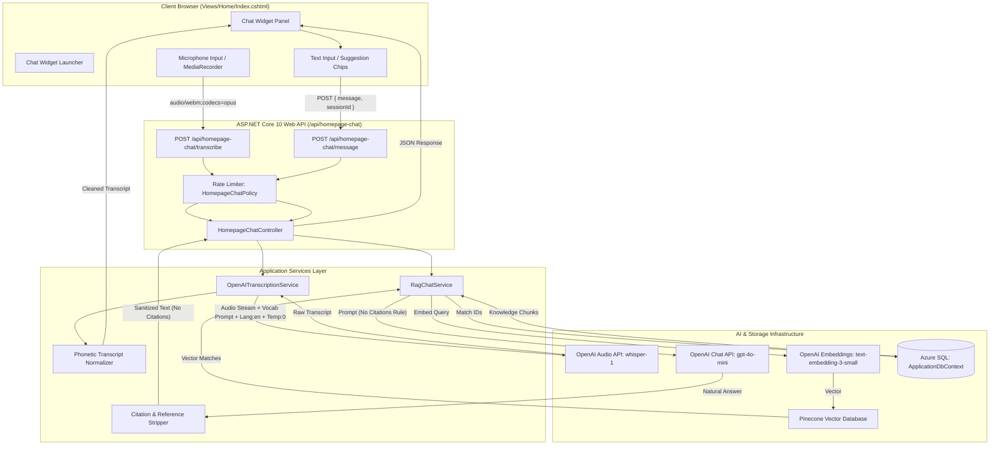
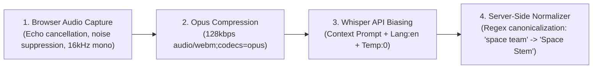

# Space Stem Homepage Chat & Voice AI Assistant Feature Guide

> [!NOTE]
> This document details the architectural design, implementation specifics, voice recognition accuracy optimizations, citation suppression mechanics, and security controls for the Space Stem Public Homepage Chat and Voice Assistant widget.

---

## 1. Executive Summary

The **Space Stem Public Homepage Chat & Voice Assistant** extends Space Stem's existing internal Retrieval-Augmented Generation (RAG) and Knowledge Base infrastructure into a public, friction-free engagement surface for visitors, job applicants, and prospective hires directly from the homepage (`/`).

### Core Value Delivered:
1. **24/7 Grounded Answers**: Answering inquiries regarding job openings, hiring pipelines, interview stages, and corporate policies using vetted company documents.
2. **Dual-Input Modality**: Instant text chatting alongside browser-based speech-to-text voice input.
3. **Clean Visitor Experience**: Suppression of raw document hashes, citations, and internal chunk references in public output.
4. **Acoustic & Vocabulary-Tuned Speech Recognition**: OpenAI Whisper engine conditioned with Space Stem brand names and HR terminology to prevent phonetic confusions (e.g., preventing "leave policy" from being heard as "live policy", or "Space Stem" as "space team").
5. **Zero Raw Audio Retention & Strong Security**: Ephemeral, in-memory audio streaming with server-side IP rate limiting.

---

## 2. System Architecture & End-to-End Data Flow

The feature reuses the existing backend RAG service (`IRagChatService`) while establishing a dedicated, anonymous-accessible API gateway and frontend widget.



---

## 3. Key Components & Implementation Details

### 3.1 Configuration (`appsettings.json` & `HomepageChatOptions`)

The widget is managed via strongly-typed options bound in `Program.cs`:

```json
{
  "HomepageChat": {
    "Enabled": true,
    "DefaultKnowledgeBaseId": 1,
    "MaxMessageLength": 1000,
    "MaxAudioSizeMB": 10,
    "EnableVoiceInput": true,
    "FallbackMessage": "I could not find this in the knowledge base. Please contact the recruitment team for help."
  },
  "OpenAI": {
    "TranscriptionEndpoint": "https://api.openai.com/v1/audio/transcriptions",
    "TranscriptionModel": "whisper-1",
    "TranscriptionLanguage": "en",
    "TranscriptionPrompt": "Space Stem, SpaceStem, HR and recruitment portal. Common topics: leave policy, annual leave, casual leave, sick leave, maternity leave, paternity leave, holidays, notice period, interview rounds, benefits, candidate evaluation, company policies."
  }
}
```

- **`HomepageChatOptions.cs`**: Models section properties (`Enabled`, `DefaultKnowledgeBaseId`, `MaxMessageLength`, `MaxAudioSizeMB`, `EnableVoiceInput`, `FallbackMessage`).
- **`OpenAIOptions.cs`**: Extended with `TranscriptionEndpoint`, `TranscriptionModel`, `TranscriptionLanguage`, and `TranscriptionPrompt`.

---

### 3.2 Public API Layer (`HomepageChatController.cs`)

Located at `Controllers/HomepageChatController.cs`, this controller exposes anonymous, rate-limited endpoints distinct from the internal, role-protected `KnowledgeBaseChatController`:

```csharp
[ApiController]
[Route("api/homepage-chat")]
[AllowAnonymous]
[EnableRateLimiting("HomepageChatPolicy")]
public class HomepageChatController : ControllerBase
```

#### Endpoints:
| HTTP Verb | Path | Request Body / Form | Purpose |
|---|---|---|---|
| `GET` | `/api/homepage-chat/config` | *None* | Returns feature toggles and limits to client (`HomepageChatConfigDto`). |
| `POST` | `/api/homepage-chat/message` | `HomepageChatMessageRequest { message, sessionId }` | Submits user question to RAG, retrieves clean answer without citations. |
| `POST` | `/api/homepage-chat/transcribe` | `multipart/form-data (IFormFile file)` | Streams audio to OpenAI Whisper and returns normalized transcript. |

#### Rate Limiting:
Implemented in `Program.cs` using ASP.NET Core's built-in `RateLimiter`:
- **Policy**: `HomepageChatPolicy` (partitioned by client IP address).
- **Quota**: 30 requests per minute with instant 429 response:
  ```json
  {
    "success": false,
    "errorMessage": "Too many requests. Please wait a moment before trying again.",
    "isFallback": true
  }
  ```

---

### 3.3 Speech-to-Text & Transcription Accuracy Engineering

Initial field tests revealed that Whisper occasionally misrecognized company and HR terms due to accent and phonetic ambiguities:
- *"Describe the leave policy of Space Stem"* $\rightarrow$ transcribed as *"Describe the live policy of space team."*
- Unrecognized query subsequently triggered RAG fallback ("could not find this in the knowledge base").

To solve this, a **4-layer accuracy pipeline** was implemented:



#### 1. Acoustic Preprocessing (Client)
In `wwwroot/js/homepage-chat-widget.js`, the browser microphone stream is requested with studio-grade speech processing constraints:
```javascript
mediaStream = await navigator.mediaDevices.getUserMedia({
  audio: {
    channelCount: 1, // Mono eliminates phase cancellation
    echoCancellation: true,
    noiseSuppression: true,
    autoGainControl: true
  }
});
```
Recorded via `MediaRecorder` targeting `audio/webm;codecs=opus` at 128 kbps.

#### 2. Domain Conditioning via Whisper `prompt` (Server)
Whisper accepts an optional `prompt` parameter (up to 224 tokens) to bias its language model toward specific vocabulary and brand names. In `OpenAITranscriptionService.cs`:
- **Prompt**: `"Space Stem, SpaceStem, HR and recruitment portal. Common topics: leave policy, annual leave, casual leave, sick leave, maternity leave, paternity leave, holidays, notice period, interview rounds, benefits, candidate evaluation, company policies."`
- **Language**: Forced to `"en"` to prevent phonetic shifts across multilingual acoustic profiles.
- **Temperature**: Set to `0` (greedy decoding) for maximum determinism and consistency.

#### 3. Post-Processing Phonetic Normalization (`NormalizeTranscript`)
Even under noise or heavy accents, common phonetic confusions are programmatically normalized before the text reaches the RAG search:
```csharp
public static string NormalizeTranscript(string text)
{
    if (string.IsNullOrWhiteSpace(text)) return text;
    var cleaned = text.Trim();

    // Brand name corrections
    cleaned = Regex.Replace(cleaned, @"\b(?:space\s+stem|spacestem|space\s+team|space\s+them|space\s+ten|space\s+time|spaceteam)\b", "Space Stem", RegexOptions.IgnoreCase);

    // HR policy corrections
    cleaned = Regex.Replace(cleaned, @"\b(?:live\s+policy|life\s+policy|leaf\s+policy)\b", "leave policy", RegexOptions.IgnoreCase);
    cleaned = Regex.Replace(cleaned, @"\b(?:live\s+balance)\b", "leave balance", RegexOptions.IgnoreCase);
    cleaned = Regex.Replace(cleaned, @"\b(?:live\s+encashment)\b", "leave encashment", RegexOptions.IgnoreCase);
    cleaned = Regex.Replace(cleaned, @"\b(?:sick\s+live)\b", "sick leave", RegexOptions.IgnoreCase);
    cleaned = Regex.Replace(cleaned, @"\b(?:annual\s+live)\b", "annual leave", RegexOptions.IgnoreCase);
    cleaned = Regex.Replace(cleaned, @"\b(?:casual\s+live)\b", "casual leave", RegexOptions.IgnoreCase);

    return cleaned;
}
```

---

### 3.4 Citation & Reference Suppression (Public Visitor UX)

While internal HR and administrative users benefit from seeing document filenames, page numbers, and chunk references in `KnowledgeBaseChatController`, public visitors should receive clean, natural, conversational answers without internal document citations.

#### Multi-Tier Suppression Architecture:
1. **Prompt Differentiation**:
   - `RagChatService.SystemPrompt`: Used for internal staff chat (`Include citations using source file name and page/chunk reference`).
   - `RagChatService.SystemPromptWithoutCitations`: Used for homepage visitors:
     > *"Do NOT mention or include any citations, references, document names, chunk numbers, or page numbers in your answer. Provide clean, natural answers."*
2. **Server-Side Regex Sanitization (`StripCitationReferences`)**:
   Cleans any accidental inline references (e.g. `(Citation 2, HR POLICY HANDBOOK_Updated.pdf, Page 36, Chunk 35)`):
   ```csharp
   public static string StripCitationReferences(string text)
   {
       if (string.IsNullOrWhiteSpace(text)) return text;
       var result = Regex.Replace(text, @"\s*\((?:Citation\s*\d*|Source|Reference|See)[^)]*\)", "", RegexOptions.IgnoreCase);
       result = Regex.Replace(result, @"\s*\[(?:Citation\s*\d*|Source|Reference)[^\]]*\]", "", RegexOptions.IgnoreCase);
       result = Regex.Replace(result, @"\s*\([^)]*\.(?:pdf|docx|txt|doc)[^)]*\)", "", RegexOptions.IgnoreCase);
       result = Regex.Replace(result, @"\s+([.,;:!?])", "$1");
       result = Regex.Replace(result, @"[ ]{2,}", " ");
       return result.Trim();
   }
   ```
3. **API Response Hygiene**:
   `HomepageChatController.SendMessage` always sets `Citations = new List<HomepageCitationDto>()` for public visitors.
4. **Client-Side Card Elimination**:
   Removed the `SOURCES FROM KNOWLEDGE BASE` card in `wwwroot/js/homepage-chat-widget.js`, presenting only the conversational bubble and optional HR email handoff when an answer cannot be found.

---

### 3.5 Frontend Widget UI & Interaction

The widget conforms to the **"Ops Desk"** and Space Stem brand aesthetic:
- **Floating Launcher**: 58px bottom-right circle in midnight navy (`#0b1531`) with pulsing beacon dot and smooth rotating toggle icon.
- **Header**: Bot avatar with real-time online status indicator, title *"Space Stem Assistant"*, New Conversation reset button (`#chatResetBtn`), and minimize button (`#chatCloseBtn`).
- **Prompt Starter Chips**: Pre-baked query suggestions (`"What roles are currently open?"`, `"What is the interview process?"`, `"What benefits are offered?"`).
- **Message List**: User bubbles (right-aligned midnight navy) and assistant bubbles (left-aligned card white with robot avatar).
- **Fallback Card**: Friendly card with direct `mailto:recruitment@spacestem.com` link when the knowledge base has no answer.
- **Live Voice Overlay**: Pulsing red indicator, elapsed recording counter (`0:05`), Cancel button, and Finish/Send button.
- **Session Continuity**: `sessionId` is preserved in `sessionStorage` (`spacestem_hp_chat_session_id`) across homepage page refreshes and sub-anchor navigation.

---

## 4. Security & Privacy Controls

| Threat / Risk | Mitigation |
|---|---|
| **API Key Exposure** | OpenAI and Pinecone API keys are kept entirely server-side in `appsettings.json` / User Secrets. The client only interacts with `/api/homepage-chat/*`. |
| **Unauthorized Internal Data Access** | Public endpoint uses `[AllowAnonymous]` pointing to a dedicated public Knowledge Base (`DefaultKnowledgeBaseId: 1`), keeping candidate resumes and sensitive HR evaluations restricted behind `Permissions.*` policies. |
| **Voice Audio Privacy** | Audio recordings are streamed via `MemoryStream` directly to OpenAI Whisper. **Zero raw audio is stored on disk or in the database.** |
| **Denial of Service (DoS) & Abuse** | Strict IP-based rate limiting (30 requests/min), maximum message length enforcement (1,000 characters), and maximum audio payload limits (10 MB). |
| **XSS & Injection Attacks** | All user inputs and assistant responses are sanitized via `escapeHtml()` before rendering to the DOM. |

---

## 5. Verification & Test Suite

The solution is covered by comprehensive automated unit tests in `RecruitmentPortal.Tests`:

### 5.1 Test Coverage Summary

| Test Class | Test Target | Key Scenarios Covered | Status |
|---|---|---|---|
| **`HomepageChatControllerTests`** | `HomepageChatController` | • Disabled feature returns HTTP 503<br>• Empty or oversized message returns HTTP 400<br>• Valid question calls RAG service with `includeCitations: false`<br>• Not found response returns configured fallback message<br>• Inline citations stripped and citations collection is empty<br>• Transcribe handles disabled states, null files, and valid streams | **Passed (10/10)** |
| **`OpenAITranscriptionServiceTests`** | `OpenAITranscriptionService` | • Empty stream and missing API key fail gracefully<br>• Sends `language: "en"`, `temperature: "0"`, and domain `prompt`<br>• `NormalizeTranscript` converts "live policy of space team" $\rightarrow$ "leave policy of Space Stem" | **Passed (7/7)** |
| **`RagChatServiceTests`** | `RagChatService` | • Validates system prompt without citations<br>• `StripCitationReferences` removes parenthetical and bracketed references | **Passed (5/5)** |
| **All Other System Tests** | Identity, Controllers, Services | • Complete suite across Candidates, Evaluation, Auth, Feedbacks | **Passed (115/115)** |
| **Total Test Suite** | Full Project | **137 unit tests** | **100% Passed** |

---

## 6. File & Directory Reference

```text
RecruitmentPortal/
├── appsettings.json                                        # HomepageChat and OpenAI configuration
├── Program.cs                                              # Service registrations and rate limiting policy
├── Controllers/
│   └── HomepageChatController.cs                          # Public API endpoints for chat & transcription
├── Models/DTOs/
│   ├── HomepageChatOptions.cs                             # Strongly-typed config model
│   ├── HomepageChatDtos.cs                                # Request & response DTOs
│   └── OpenAIOptions.cs                                   # Extended with transcription settings
├── Services/
│   ├── IOpenAITranscriptionService.cs                     # Transcription interface
│   ├── OpenAITranscriptionService.cs                      # Whisper integration & transcript normalizer
│   ├── IRagChatService.cs                                 # RAG interface with includeCitations toggle
│   └── RagChatService.cs                                  # Dual prompt & citation stripper
├── Views/Home/
│   └── Index.cshtml                                       # Homepage markup integrating the widget
├── wwwroot/
│   ├── css/homepage-chat-widget.css                       # Responsive widget stylesheet
│   └── js/homepage-chat-widget.js                         # Widget controller, audio recorder & API client
└── docs/
    └── Homepage_Chat_and_Voice_Widget_Feature_Guide.md     # This comprehensive technical guide
```
