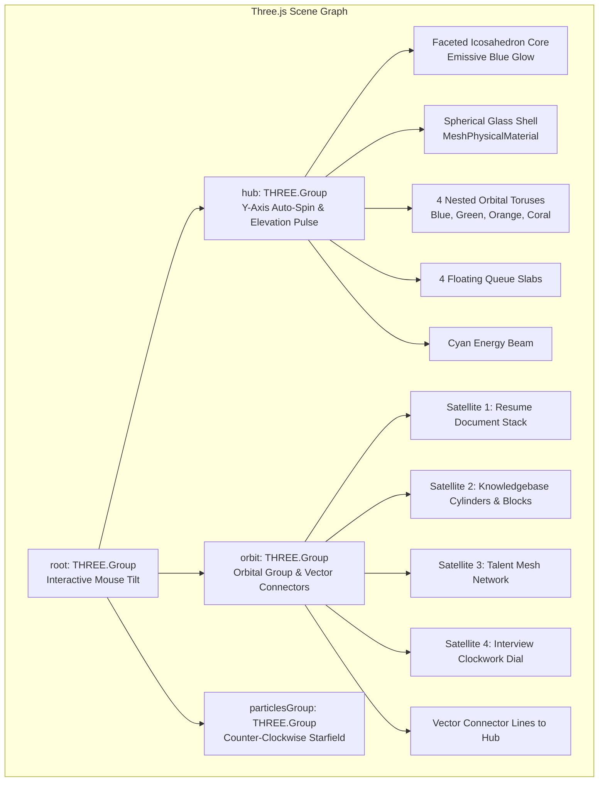
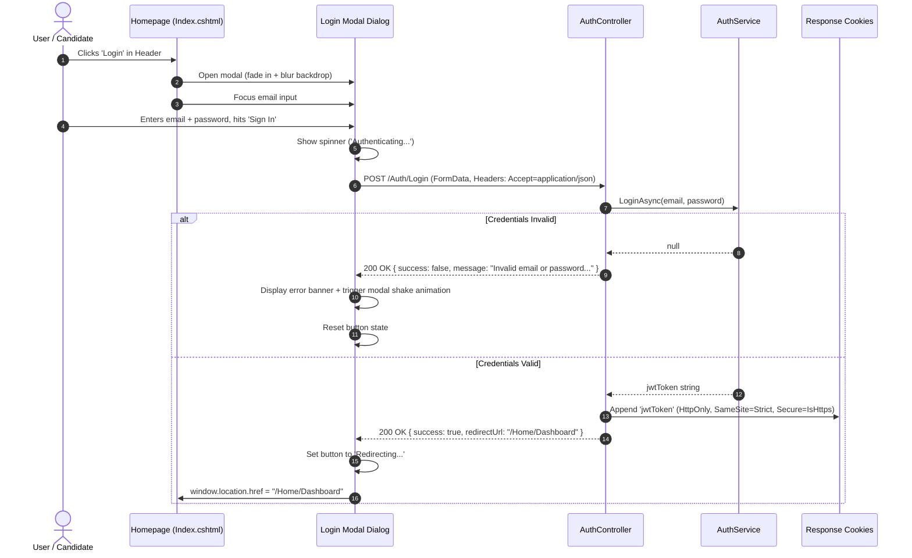

# Space Stem HR 3D Homepage & Authentication Integration Guide

> [!NOTE]
> This document details the architecture, 3D WebGL animation mechanics, authentication routing, and design system alignment for the Space Stem HR Recruitment Portal homepage feature.

---

## 1. Executive Summary

Prior to this feature, the Recruitment Portal lacked a public-facing entry point—navigating to the root path (`/`) immediately challenged unauthenticated visitors and redirected them to a standalone login form. 

The **Space Stem 3D Homepage** elevates the portal by introducing:
1. **A public marketing and candidate experience surface** (`/`) featuring an interactive Three.js 3D hero animation, recruitment workflow highlights, and AI feature showcases.
2. **Seamless authentication delegation**: The login experience is embedded directly onto the **Login** CTA buttons via an accessible, glassmorphism modal dialog with AJAX submission and inline validation.
3. **Clean separation of concerns**:
   - Public landing page: `HomeController.Index` (`[AllowAnonymous]`)
   - Protected recruitment workspace: `HomeController.Dashboard` (`[Authorize]`)
4. **Adaptive user state**: When authenticated staff members visit the public homepage, navigation links dynamically adapt (showing "Dashboard" in the central navigation and user greetings + logout in the header), eliminating visual duplication.

---

## 2. System Architecture & Routing Flow

```mermaid
flowchart TD
    User([User Request /]) --> RootRoute{Is User Authenticated?}
    
    RootRoute -- Anonymous --> PublicHome[Views/Home/Index.cshtml\nSpace Stem 3D Homepage]
    RootRoute -- Authenticated --> PublicHomeAuth[Views/Home/Index.cshtml\n3D Homepage with Staff Header & Nav]
    
    PublicHome -- Clicks 'Login' CTA --> LoginModal[In-Page Interactive Login Modal]
    PublicHome -- Direct Link / Non-JS --> LoginRoute[/Auth/Login or /login]
    
    LoginModal -- AJAX POST /Auth/Login --> AuthCtrl[AuthController.Login]
    LoginRoute -- Form POST /Auth/Login --> AuthCtrl
    
    AuthCtrl -- Valid Credentials --> IssueJWT[Issue HTTP-Only jwtToken Cookie]
    AuthCtrl -- Invalid Credentials --> ReturnError[Return JSON Error / Modal Shake]
    
    IssueJWT --> RedirectDash[/Home/Dashboard]
    PublicHomeAuth -- Clicks 'Dashboard' in Nav --> RedirectDash
    
    RedirectDash --> StaffDesk[Views/Home/Dashboard.cshtml\nRecruitment Ops Dashboard]
```

### 2.1 Routing Overview

| Route | Controller / Action | Authorization | Purpose |
|---|---|---|---|
| `/` or `/Home` | `HomeController.Index` | `[AllowAnonymous]` | Public Space Stem 3D landing page |
| `/Home/Dashboard` | `HomeController.Dashboard` | `[Authorize]` | Core operational recruitment dashboard |
| `/login` or `/Auth/Login` (GET) | `AuthController.Login` | `[AllowAnonymous]` | Dedicated login page fallback (redirects to Dashboard if already logged in) |
| `/login` or `/Auth/Login` (POST) | `AuthController.Login` | `[AllowAnonymous]` | Handles both JSON/AJAX modal login and standard form submissions |
| `/Auth/Logout` (POST) | `AuthController.Logout` | `[Authorize]` | Clears `jwtToken` cookie and redirects to `/` |

---

## 3. The 3D Animation Engine (Three.js WebGL)

The 3D hero scene is rendered in an HTML5 canvas element (`#hero-3d`) layered behind the textual hero content. It is powered by a local, bundled instance of **Three.js** (`wwwroot/vendor/three.min.js`) and orchestrated by `wwwroot/js/homepage-3d.js`.



### 3.1 Core Three.js Components

#### 1. Scene & Renderer Setup
- **Renderer**: `THREE.WebGLRenderer` configured with:
  - `alpha: true` (transparent background allowing the CSS radial/mesh gradient to show through).
  - `antialias: true` for smooth edges on high-DPI displays.
  - `powerPreference: "high-performance"` to hint the GPU.
  - `outputEncoding = THREE.sRGBEncoding` for accurate color science.
  - Pixel ratio capped at `Math.min(window.devicePixelRatio || 1, 2)` to protect mobile battery and performance.
- **Camera**: `THREE.PerspectiveCamera(42, aspect, 0.1, 100)` configured dynamically per responsive breakpoint.

#### 2. Illumination Model
The scene uses a 4-point cinematic lighting rig:
- **Hemisphere Ambient Light**: `0xf7fbff` (sky) to `0x61718b` (ground), intensity `1.55`. Provides gentle, non-harsh global ambient lighting.
- **Directional Key Light**: Pure white `0xffffff`, intensity `2.2` positioned at `(-5, 6, 7)`.
- **Rim Light**: Cyan `0x79ddff`, intensity `2.1`, distance `18` positioned at `(5, 2.8, 5)`. Gives edges a cybernetic outline.
- **Warm Fill Light**: Orange `0xfa9418`, intensity `0.95`, distance `16` at `(-2.5, -3, 4)`. Softens shadows on lower surfaces.

#### 3. Shaders & Material System
- **Hub Glass Shell**: Uses `THREE.MeshPhysicalMaterial` with:
  - `roughness: 0.18`, `metalness: 0`, `clearcoat: 0.9`
  - `opacity: 0.76`, `transparent: true`, `side: THREE.DoubleSide`
- **Glow Elements & Accents**: Uses `THREE.MeshStandardMaterial` with custom emissive channels (`emissiveIntensity: 0.05 - 0.22`) matching the Space Stem brand palette:
  - Space Stem Blue: `#3f98d4` (`0x3f98d4`)
  - Space Stem Green: `#4db948` (`0x4db948`)
  - Space Stem Orange: `#fa9418` (`0xfa9418`)
  - Space Stem Coral: `#fb694f` (`0xfb694f`)
  - Space Stem Navy: `#0b1531` (`0x101b38`)
  - Space Stem Cyan: `#79ddff` (`0x79ddff`)

#### 4. The 4 Interactive Satellites
Four compound meshes rotate around the core, each visually representing a core value proposition:
1. **AI Resume Scanning Stack**: 3 angled white paper meshes with animated indicator lines and a green completed check badge.
2. **Company Knowledgebase Stack**: 4 rotating rectangular blocks stacked on a solid dark base, symbolizing layered company policies and role briefs.
3. **Smart Talent Network**: Constellation of spherical nodes linked by cyan vector lines, indicating interconnected candidate pools and matchmaking.
4. **Interview Automation Dial**: An analog timepiece dial with dual hands and a coral outer rim, communicating scheduling speed and precision.

#### 5. Background Particle Galaxy
240 float vector points generated via parametric trigonometric distributions:
```javascript
const radius = 2.2 + Math.random() * 3.8;
const angle = Math.random() * Math.PI * 2;
particlePositions[i * 3] = Math.cos(angle) * radius;
particlePositions[i * 3 + 1] = -2.2 + Math.random() * 4.4;
particlePositions[i * 3 + 2] = Math.sin(angle) * radius * 0.36;
```
Rendered as `THREE.Points` with additive depth attenuation to give ambient 3D depth behind the command hub.

---

### 3.2 Responsive Camera & Breakpoint Calculations

The scene updates in real-time on window resize via `positionScene()`:

| Viewport Width | Camera Position `(x, y, z)` | Root Center `(x, y, z)` | Scale | Rationale |
|---|---|---|---|---|
| **Mobile (`< 720px`)** | `(0, 1.15, 8.7)` | `(1.22, -1.08, 0)` | `0.66` | Shifts 3D hub below text content to prevent visual overlap |
| **Tablet (`720px - 1120px`)** | `(0.18, 1.1, 8.35)` | `(1.1, -0.32, 0)` | `0.90` | Semi-centered, scaled to fit side-by-side |
| **Desktop (`> 1120px`)** | `(0.8, 1.18, 7.5)` | `(2.74, -0.08, 0)` | `0.92` | Anchored to the right half, framing hero typography on the left |

### 3.3 User Interaction & Physics Parallax

- **Smooth Dampening (Lerp)**: Mouse coordinates are normalized to `[-1, 1]`. On each frame of `requestAnimationFrame`:
  ```javascript
  pointer.lerp(targetPointer, 0.045);
  root.rotation.y += (pointer.x * 0.08 - root.rotation.y) * 0.025;
  root.rotation.x += (-pointer.y * 0.05 - root.rotation.x) * 0.025;
  ```
- **Autonomous Rotation**: Rings counter-rotate at independent speeds; satellites oscillate on individual sine/cosine phase offsets so the scene never feels static.
- **Card Synchronization**: Active feature chip cycler triggers every `2800ms`, synchronizing UI cards with the 3D domain objects.

### 3.4 Accessibility & Fallbacks

> [!TIP]
> The implementation strictly respects system accessibility settings and hardware constraints.

1. **`prefers-reduced-motion` Support**:
   - Monitored via `window.matchMedia("(prefers-reduced-motion: reduce)")`.
   - Halts all automated rotation loops, orbit movements, and particle spinning.
   - Renders a single static frame oriented toward the user without continuous GPU cycles.
2. **WebGL Detection & CSS Fallback**:
   - `supportsWebGL()` creates an in-memory test canvas and probes for `webgl` / `experimental-webgl`.
   - If WebGL is unavailable or fails, `.three-fallback` is appended to the `.hero` container.
   - The canvas hides and 3 CSS-animated 3D glass cards (`.scene-fallback span`) float in isometric 3D using pure CSS keyframes (`fallbackFloat`).

---

## 4. In-Page Authentication Modal & AJAX Pipeline

Rather than throwing users immediately onto a bare login form, login functionality is encapsulated into the **Login** CTA.



### 4.1 Key Modal Features
- **Keyboard Navigation**: Pressing `Escape` closes the modal; clicking the backdrop dismisses it.
- **Password Visibility Toggle**: Interactive eye icon toggles `type="password"` and `type="text"`.
- **Progressive Enhancement**: Contains `@Html.AntiForgeryToken()` and standard form attributes (`action="/Auth/Login" method="post"`). If JavaScript is disabled or network fails, it automatically submits via a standard HTTP POST.
- **Direct Link Support**: Right-clicking the Login button to open in a new tab routes directly to `/Auth/Login` (or `/login`).

---

## 5. View Segregation & Layouts

```
RecruitmentPortal/
├── Views/
│   ├── Home/
│   │   ├── Index.cshtml        <-- Public Space Stem 3D landing page (Layout = null)
│   │   └── Dashboard.cshtml    <-- Authenticated recruitment ops desk (Uses _Layout.cshtml)
│   ├── Shared/
│   │   ├── _Layout.cshtml      <-- Charcoal sidebar navigation for internal staff
│   │   └── _LoginPartial.cshtml<-- User profile badge & logout trigger
│   └── Auth/
│       └── Login.cshtml        <-- Standalone split-screen login page fallback
```

### 5.1 Dynamic State on the Public Homepage

When an authenticated staff member navigates to `/`:
1. **Header Left**: Space Stem Logo.
2. **Header Center**: Navigation links (`Workflow`, `AI Features`, `Demo`) + **`Dashboard`** (links directly to `/Home/Dashboard`).
3. **Header Right**: User greeting `Hi, {FirstName}` and a discreet **Logout** icon button.
4. **Hero Actions**: Standard `Explore workflow` and `View AI features` actions (redundant dashboard buttons omitted).

---

## 6. Verification & Test Suite

The solution is verified by automated unit tests in `RecruitmentPortal.Tests`:

```
Test Run Summary:
  Total Tests:   110
  Passed:        110
  Failed:        0
  Skipped:       0
  Duration:      1.1 seconds
```

### Key Test Classes
- `HomeControllerTests.cs`:
  - `Index_ShouldReturnView()`
  - `Dashboard_ShouldReturnViewWithDashboardViewModel()`
  - `Privacy_ShouldReturnView()`
- `AuthControllerTests.cs`:
  - `Login_Get_ShouldReturnView_WhenNotAuthenticated()`
  - `Login_Get_ShouldRedirectToDashboard_WhenAuthenticated()`
  - `Login_Post_ShouldRedirectToDashboard_WhenCredentialsValid()`
  - `Login_Post_ShouldReturnViewWithError_WhenCredentialsInvalid()`
  - `Login_Post_ShouldReturnJsonSuccess_WhenAjaxAndCredentialsValid()`
  - `Login_Post_ShouldReturnJsonError_WhenAjaxAndCredentialsInvalid()`
  - `Logout_ShouldDeleteCookieAndRedirectToHomeIndex()`
