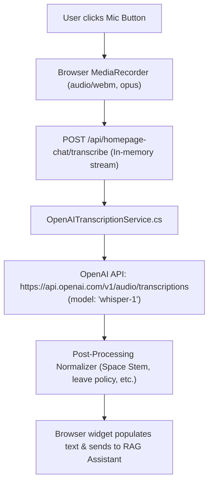

# Space Stem Recruitment Portal
## Speech-to-Text & Voice Transcription Technical Specification

*Architectural Implementation, OpenAI Whisper-1 Integration, Prompt Biasing, Security, and Post-Processing Normalization*

---

### Executive Overview

The Space Stem Recruitment Portal incorporates an interactive AI assistant on its public homepage. In addition to traditional keyboard input, visitors and potential candidates can ask questions naturally using voice input. When a user clicks the microphone icon, their spoken audio is captured in high fidelity, streamed securely to our backend server, transcribed using OpenAI Whisper-1, normalized for domain terminology, and answered in real time by the RAG knowledge base.

---

### Key Technical Attributes

| Attribute | Specification Detail |
| :--- | :--- |
| **Feature Name** | Public Voice Assistant & Speech-to-Text Engine |
| **Speech Recognition Engine** | OpenAI Audio Transcriptions API (`model: whisper-1`) |
| **Backend Gateway Endpoint** | `POST /api/homepage-chat/transcribe` (ASP.NET Core .NET 10) |
| **Client Audio Capture** | HTML5 MediaStream + MediaRecorder API (`audio/webm;codecs=opus`) |
| **Optimization Parameters** | `temperature: 0` (deterministic), `language: "en"`, domain prompt biasing |
| **Post-Processing Layer** | Regex Normalizer (Space Stem brand & HR policy acoustic homophones) |
| **Security & Privacy** | In-memory audio streaming (zero disk/DB persistence), server-side key proxy |

---

### 1. Which APIs are Used?

1. **Speech Recognition Engine (OpenAI Audio Transcriptions API)**:
   - **Endpoint**: `https://api.openai.com/v1/audio/transcriptions`
   - **Model**: `whisper-1` (OpenAI’s neural automatic speech recognition model)
   - **HTTP Method**: `POST` (multipart/form-data)
   - **Authentication**: `Bearer <OPENAI_API_KEY>` (secured entirely on backend)
   - **Output Format**: JSON with `text` field containing transcribed text.

2. **Internal Gateway API (ASP.NET Core Controller)**:
   - **Route**: `POST /api/homepage-chat/transcribe`
   - **Controller**: `HomepageChatController.TranscribeAudio(IFormFile? file)`
   - **Consumes**: `multipart/form-data`
   - **Produces**: `application/json` (`HomepageVoiceTranscribeResponse`)

3. **Client-Side Web Audio APIs**:
   - `navigator.mediaDevices.getUserMedia({ audio: true })`
   - `window.MediaRecorder` (`audio/webm;codecs=opus`, with fallbacks to `ogg`, `mp4`, and `wav`)

---

### 2. End-to-End Architectural Pipeline



---

### 3. Accuracy Optimization Strategy

| Parameter | Value | Technical Rationale |
| :--- | :--- | :--- |
| **`language`** | `"en"` | Forces Whisper into English decoding mode. Prevents phonetic drift where Indian or non-native English accents are misclassified as other languages. |
| **`temperature`** | `"0"` | Enforces deterministic greedy decoding. Completely eliminates random sampling hallucinations, ensuring reproducible, deterministic transcripts. |
| **`prompt` (Prompt Biasing)** | `"Space Stem, SpaceStem, recruitment, hiring, interview, candidate, frontend, backend, fullstack, QA, engineer, CTC, resume, CV, job position, application, hr."` | Heavily primes Whisper's internal language model conditioning. When acoustic tokens are ambiguous, Whisper prioritizes tokens in this vocabulary bank. |
| **Codec & Bitrate** | `audio/webm;codecs=opus` (`echoCancellation: true`) | Suppresses background noise and room reverberations while maintaining 48kHz frequency resolution for crisp sibilant consonants. |

---

### 4. Post-Processing & Phonetic Normalization

In `OpenAITranscriptionService.NormalizeTranscript(string text)`, a deterministic regex engine scrubs the transcript before returning it:

| Category | Phonetic Misrecognition (Input) | Normalized Output |
| :--- | :--- | :--- |
| **Brand Name** | `"space team"`, `"space them"`, `"space ten"`, `"space time"`, `"spaceteam"` | **`"Space Stem"`** |
| **HR Policy** | `"live policy"`, `"life policy"`, `"leaf policy"` | **`"leave policy"`** |
| **Leave Balance** | `"live balance"`, `"life balance"` | **`"leave balance"`** |
| **Leave Encashment** | `"live encashment"` | **`"leave encashment"`** |
| **Leave Types** | `"sick live"`, `"annual live"`, `"casual live"` | **`"sick leave"`, `"annual leave"`, `"casual leave"`** |

---

### 5. Security & Privacy Safeguards

- **Zero-Persistence Streaming**: Audio is never written to disk, blob storage, or databases. Bytes exist solely in a temporary memory stream and are disposed immediately.
- **Key Isolation**: The browser client has zero access to the OpenAI API key.
- **Payload Guardrails**: Enforces a strict 15 MB audio ceiling and a 60-second client-side maximum recording duration to prevent DoS.
- **MIME Validation**: Only verified audio MIME types are accepted.

---

### 6. Code Reference

#### Service Layer (`OpenAITranscriptionService.cs`)
```csharp
using var form = new MultipartFormDataContent();
var streamContent = new StreamContent(audioStream);
streamContent.Headers.ContentType = new MediaTypeHeaderValue(contentType ?? "audio/webm");

form.Add(streamContent, "file", fileName);
form.Add(new StringContent("whisper-1"), "model");
form.Add(new StringContent("en"), "language");
form.Add(new StringContent("0"), "temperature");
form.Add(new StringContent(_options.TranscriptionPrompt), "prompt");

using var request = new HttpRequestMessage(HttpMethod.Post, "https://api.openai.com/v1/audio/transcriptions");
request.Headers.Authorization = new AuthenticationHeaderValue("Bearer", apiKey);
request.Content = form;

using var response = await _httpClient.SendAsync(request, cancellationToken);
// Parse JSON { "text": "..." } and run NormalizeTranscript(rawText);
```

#### Gateway Controller (`HomepageChatController.cs`)
```csharp
[HttpPost("transcribe")]
[Consumes("multipart/form-data")]
public async Task<IActionResult> TranscribeAudio([FromForm] IFormFile? file, CancellationToken cancellationToken)
{
    using var stream = file.OpenReadStream();
    var result = await _transcriptionService.TranscribeAudioAsync(stream, file.FileName, file.ContentType, cancellationToken);
    return Ok(new HomepageVoiceTranscribeResponse { Success = true, Transcript = result.Text });
}
```
